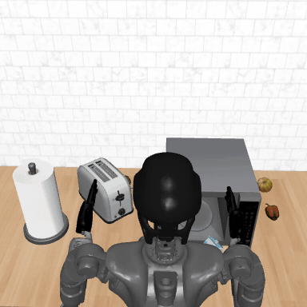

# GR00T, measured: a virtual robot on RTX 5090, Jetson AGX Thor and Jetson AGX Orin

**So you want to see how well GR00T works? You've found the right repo.**

NVIDIA's GR00T N1.5 is a robot *policy*: it looks at a camera image, reads an instruction, and outputs motor commands.
We put it in charge of simulated robots and measured two things on three NVIDIA machines: **how fast it decides** and
**whether it still decides the same way**:

- **a humanoid** putting milk in a microwave ([the headline](#the-headline));
- **a simulated drone** flying to a named pillar, with GR00T's vision-language half and a new action head ([same brain, new body](#new-same-brain-new-body-gr00t-flies-a-simulated-drone));
- and NVIDIA's **GEAR-SONIC** controller, which keeps a humanoid balanced at 50 Hz ([below](#also-measured-gear-sonic-the-controller-that-keeps-a-humanoid-on-its-feet)).

Every script we ran is here, along with the raw data and a checker that rebuilds the published numbers from it. There
are also scripts for the Qualcomm IQ-9075, so you can measure that one yourself (we publish no IQ-9075 results).

## The headline

<!-- results:start -->
| Machine | Whole policy call (MEASURED) | Closed loop: success, 20 seeds | Same outcome as the RTX 5090 |
|---|---|---|---|
| RTX 5090 | 13.65 ms = **73.3 Hz** (full TensorRT) | 9/20 (bf16, the reference) | -- |
| Jetson AGX Thor | 48.27 ms = **20.7 Hz** | 10/20 fp16 · 8/20 bf16 · 10/20 fp8 | **19/20 fp16** · 19/20 bf16 · 17/20 fp8 |
| Jetson AGX Orin 64 GB | 88.01 ms = **11.4 Hz** | 9/20 fp16 | **20/20 fp16** |

Speed = NVIDIA's full TensorRT path, fp16 engines, image + instruction in, action chunk out. Closed-loop runs use PyTorch on each board, so their latencies are not the speed column. At n = 20 every success rate's 95% interval is about ±20 points: both Jetsons, at every precision, are statistically indistinguishable from the 5090 reference. The Thor fp16 run is from 2026-10-12 on a newer PyTorch stack; the other closed-loop runs are from 2026-09-18 ([RESULTS.md §5](RESULTS.md#5-accuracy-closed-loop-task-success-across-boards-measured-2026-09-18-thor-fp16-2026-10-12)).
<!-- results:end -->

Every number, with how it was measured: [RESULTS.md](RESULTS.md).

## New: same brain, new body: GR00T flies a simulated drone

We kept GR00T N1.5's vision-language backbone frozen and trained a small action head (1.35 M weights) to fly a simulated
quadrotor in MuJoCo: camera image + "fly to the red pillar" in, 16 velocity setpoints out, 20 ms apart (no diffusion
transformer: the small head replaces GR00T's action head). On each machine we timed the whole decision, checked its output against the RTX 5090's, flew 40 held-out
episodes, and loaded the computer with other AI jobs a drone might run. Details: [drone/README.md](drone/README.md).
IQ-9075: reproduction scripts in [drone/iq9/](drone/iq9/README.md), no results published.

<!-- drone:start -->
| Machine | One decision, full cost | Same decisions as the RTX 5090? | Reached the pillar, 40 simulated flights: lockstep · back-to-back at its own latency | Decision rate during a 50 MP inspection burst |
|---|---|---|---|---|
| RTX 5090 | 7.16 ms = **139.7 Hz** (147.5 Hz pinned to performance cores) | PASS (0.027σ) | 32/40 · 33/40 | **81.71 Hz** (70% of its 115.9 Hz alone in that run) |
| Jetson AGX Thor | 24.49 ms = **40.8 Hz** | PASS (0.026σ) | 34/40 · 35/40 | **18.15 Hz** (44% of its 41.1 Hz alone in that run) |
| Jetson AGX Orin 64 GB | 44.94 ms = **22.2 Hz** | PASS (0.029σ) | 35/40 · 36/40 | **11.96 Hz** (54% of its 22.2 Hz alone in that run) |

MEASURED in simulation (percentages and p-values DERIVED). *Full cost*: camera frame + prompt + drone state in, setpoints out, host work included (TensorRT fp16). *Same decisions*: on 256 frames, the setpoints each machine would fly deviate from the RTX 5090 running the policy in plain PyTorch by 0.026–0.029σ (RMS over all frames; limit 0.07σ; σ = the spread of each setpoint in the training data). The RTX 5090's rate during the burst is against its own run alone, which was slower than 139.7 Hz because its hybrid CPU moved the process to efficiency cores; pinned to performance cores it ran 147.3 Hz alone and 86.0 Hz (58%) during the burst. *Lockstep*: the simulator pauses while the policy decides. *Back-to-back*: the drone keeps flying while the next decision is computed, so each new plan lands as late as the decision took (Thor and Orin measured; the RTX 5090's 7.2 ms applied as one injected 20 ms tick). In this simulator reach hardly depends on speed, and no machine differs from the RTX 5090 at p < 0.05; 40 flights rule out only a large drop.

**Speed is the difference.** Against our 30 Hz target (a design choice; any target from 23 to 39 Hz gives the same verdict), the RTX 5090 and Thor keep up alone and Orin does not; during the inspection burst only the RTX 5090 does. The RTX 5090 is a desktop reference, not a drone computer. Both extra loads are stress cases: real drones usually run 50 MP inspection on a payload computer or after the flight, and a 3B vision-language-action model is far heavier than the navigation networks production drones fly. [RESULTS.md §9](RESULTS.md#9-gr00t-as-a-drones-flight-brain-measured-2026-10-14--2026-10-15)
<!-- drone:end -->

Run it on an x86 Linux PC with an NVIDIA GPU (Thor and Orin: [drone/README.md](drone/README.md#jetson-agx-orin-jetpack-6-and-jetson-agx-thor-jetpack-7)):

```bash
git clone https://github.com/kylefoxaustin/groot-virtual-robot-bench.git && cd groot-virtual-robot-bench
source setup/env.sh && bash setup/setup_x86.sh --policy-only   # GR00T env + base model, ~20 GB
bash drone/setup.sh                                            # MuJoCo, ONNX export, the 3 TensorRT engines
bash drone/run_fullcost.sh mygpu rtx5090                       # decision rate + output gate, next to ours
$GROOT_PY drone/closed_loop.py --out $DRONE_RUNS/cl --arm k4 --K 4 --episodes 0-9   # 10 flights, then compare:
python3 drone/compare_closed_loop.py $DRONE_RUNS/cl/k4_episodes.jsonl results/drone/raw/closed_loop/rtx5090_trt_np_K4_llvmpipe.jsonl
```

## Also measured: GEAR-SONIC, the controller that keeps a humanoid on its feet

GR00T decides *what* to do a few times a second; a whole-body controller has to keep the robot balanced 50 times a second.
We ran NVIDIA's **GEAR-SONIC** ([NVlabs/GR00T-WholeBodyControl](https://github.com/NVlabs/GR00T-WholeBodyControl), unmodified
apart from a timing probe) on a simulated **Unitree G1** in MuJoCo: the same 82 s script (stand, drop, walk, turn, run, dance) on
each machine, with the simulator on the same computer, idle and under load. Details: [sonic/README.md](sonic/README.md).
IQ-9075: reproduction scripts in [iq9/sonic/](iq9/sonic/README.md), no results published.

<!-- sonic:start -->
| Machine | Load | Runs | Step p50 / p99 ms | Compute misses (step > 20 ms) | Slot misses (gap > 25 ms) | Late starts (gap > 21 ms) | Max gap ms | Falls, D1 rule (drop ≤ 3 s · later) |
|---|---|---|---|---|---|---|---|---|
| RTX 5090 | unloaded | 3 | 0.21–0.24 / 2.53–2.59 | 0 | 0 | 0 | 20.17 | 0/3 (0 · 0) |
| Jetson AGX Thor | unloaded | 10 | 0.72–0.74 / 4.76–4.83 | 0 | 0 | 1 | 21.06 | 3/10 (3 · 0) |
| Jetson AGX Orin 64 GB | unloaded | 10 | 1.05–1.07 / 7.64–7.68 | 0 | 0 | 0 | 20.15 | 1/10 (1 · 0) |
| Jetson AGX Thor | CPU saturated | 3 | 0.75–0.76 / 6.03–7.09 | 11 | 16 | 316 | 40.03 | 0/3 (0 · 0) |
| Jetson AGX Thor | GPU co-tenant | 3 | 3.79–3.86 / 11.47–11.76 | 0 | 0 | 6 | 21.88 | 0/3 (0 · 0) |
| Jetson AGX Orin 64 GB | CPU saturated | 3 | 1.14–1.26 / 132.53–153.73 | 571 | 567 | 686 | 341.78 | 3/3 (1 · 3) |
| Jetson AGX Orin 64 GB | GPU co-tenant | 3 | 5.11–5.25 / 14.32–18.17 | 91 | 6 | 82 | 26.81 | 1/3 (1 · 0) |
| RTX 5090 | loaded | n/a — not measured (the loaded arms ran on the Jetsons only) | | | | | | |

MEASURED. Same upstream program, probe, step span, keyboard script and scoring on all three; ranges are across runs, counts are totals over all runs. 50 Hz = a new step every 20 ms. Unloaded, no computer missed a step deadline or a slot (worst step 11.10 ms; worst gap 21.06 ms). Under CPU saturation the stock Orin misses deadlines and falls, and the hogs also starve the simulator on the same CPU. Falls are counted by the D1 rule: any simulator fall-reset from the band-off command to the stop (in brackets: runs with one within 3 s of the command · runs with one later). Planner engine accuracy, the TF32 finding, loaded-arm details and caveats: [RESULTS.md §8](RESULTS.md#8-gear-sonic-whole-body-controller-the-50-hz-loop-on-each-computer-measured-2026-10-13--2026-10-14).

**Band-drop falls (controlled test, MEASURED):** with the release from the simulator's elastic band controlled at D = 10–100 ms after the command (3 runs per D, stock deploy), every machine fell at some delay: RTX 5090 3/18, Thor 3/18, Orin 3/18 (2/17 counting a bit-identical pair once); 95% intervals 0.036–0.414 each (DERIVED). No dependence on D was shown, and control timing was clean in every run: the falls are a drop transient of this sim2sim harness, not a computer's timing. Runs can repeat bit for bit, so the intervals are optimistic. [RESULTS.md §8.1](RESULTS.md#81-controlled-band-drop-test-measured-2026-10-14)

**Late-start fix on the Jetsons (MEASURED):** a deployment change, control thread SCHED_FIFO 90 + sleeping main loop instead of upstream's busy-spinning FIFO-99 main thread (needs root or CAP_SYS_NICE):

| Machine | Load | Compute misses, stock → fix | Slot misses, stock → fix | Falls (D1), stock → fix |
|---|---|---|---|---|
| Jetson AGX Orin 64 GB | unloaded | 0 → **0** | 0 → **0** | 1/10 → 1/3 |
| Jetson AGX Orin 64 GB | CPU saturated | 571 → **0** | 567 → **0** | 3/3 → 1/3 |
| Jetson AGX Orin 64 GB | GPU co-tenant (GR00T) | 91 → **46** | 6 → **10** | 1/3 → 1/3 |
| Jetson AGX Thor | unloaded | 0 → **0** | 0 → **0** | 3/10 → 0/3 |
| Jetson AGX Thor | CPU saturated | 11 → **0** | 16 → **0** | 0/3 → 0/3 |
| Jetson AGX Thor | GPU co-tenant (GR00T) | 0 → **0** | 0 → **0** | 0/3 → 0/3 |

Stock = the runs above (3 per loaded arm, 10 unloaded); fix = 3 runs per arm. On the Orin with GR00T on the same GPU the fix halves the compute misses but slot misses rise (6 → 10), attributed to GPU sharing (inferred, not traced). [RESULTS.md §8.2](RESULTS.md#82-late-start-fix-on-the-jetsons-measured-2026-10-14)
<!-- sonic:end -->

## Meet the virtual robot

<p align="center">
  
  <br><em>GR00T N1.5 (RoboCasa post-trained) driving the GR1 on an RTX 5090: one successful episode, ~7x speed.</em>
</p>

A **Fourier GR1** humanoid (two arms, two hands, a waist) in **RoboCasa** (a MuJoCo simulator), told to *pick up the
milk, put it in the microwave and close the door*. A few numbers decide everything:

- **20 Hz**: the arm takes a new joint command every 50 ms.
- **16 steps**: each GR00T decision returns a 16-step *action chunk*, i.e. 800 ms of motion.
- So a board doesn't need to decide 20 times a second. It needs to finish the **next** decision before the current chunk
  runs out. "Hz" in our speed tables means *decisions per second*, not commands per second.
- **4 denoise steps**: GR00T plans each chunk with a small diffusion model, refined 4 times by default. More steps cost
  time linearly and shrink the difference from a 64-step reference only about 1/N -- that is solver error, not task
  success ([RESULTS.md §2](RESULTS.md#2-denoise-steps-cost-vs-solver-deviation-rtx-5090-measured)).

The speed runs time the base GR00T N1.5 model on one recorded frame of NVIDIA's simulated GR1 demo; the closed loop runs
the RoboCasa post-trained model on the milk task.

## Words we use

- **Policy call**: one full decision -- image + instruction in, action chunk out. Our speed numbers time exactly this.
- **ViT / LLM / DiT**: GR00T's three big parts -- the vision encoder (camera image to tokens), the language model, and
  the diffusion transformer that plans the action chunk (run once per denoise step). Four small modules glue them together.
- **Eager / hybrid / full TensorRT**: plain PyTorch; only ViT, LLM and DiT compiled with TensorRT; all 7 modules
  compiled (NVIDIA's own deployment path).
- **Closed loop**: the policy drives the simulator and sees the result of its own actions, for a whole episode.
- **Seed**: one reproducible episode (scene layout + diffusion noise). We run seeds 0-19.
- **Success** vs **same outcome**: success = the task got done; same outcome = on how many of the 20 seeds the board's
  success or failure matched the RTX 5090's.
- **bf16 / fp16 / fp8**: number formats for the arithmetic, from 16-bit down to 8-bit floating point.
- **MEASURED / DERIVED / SOURCED**: we ran it / we computed it from measurements / someone else published it.

## Pick your adventure

| I have... | Do this | You get | Time |
|---|---|---|---|
| **Just a laptop** | `git clone https://github.com/kylefoxaustin/groot-virtual-robot-bench.git && cd groot-virtual-robot-bench && python3 -m venv /tmp/v && /tmp/v/bin/pip install numpy && /tmp/v/bin/python tools/check_results.py` | our speed, denoise, closed-loop and DDR numbers rebuilt from the shipped raw data; it prints `OK` or what differs. The numbers themselves are in [RESULTS.md](RESULTS.md) | ~1 min |
| **An x86 Linux PC with an NVIDIA GPU** | [docs/SETUP.md](docs/SETUP.md), then [docs/SPEED.md](docs/SPEED.md) | eager vs hybrid vs full-TensorRT policy-call speed on your GPU, two engine builds | setup: ~22 GB of models and sim assets plus several GB of pip wheels |
| ...the same PC, and patience | [docs/SETUP.md](docs/SETUP.md), then [docs/ACCURACY.md](docs/ACCURACY.md) | 20 closed-loop episodes on your GPU, seed by seed against our shipped RTX 5090 run | 20 episodes × 720 sim steps; GPU time is only ~1 min of it (900 calls × ~60 ms on the 5090), the simulator the rest |
| **A Jetson AGX Thor or Orin** | the same two docs; each has a Jetson section | the same speed run on the board, and the board as closed-loop policy server (the simulator stays on an x86 PC) | |
| **Any of the above, and you want the drone** | [drone/README.md](drone/README.md) | the drone's decision rate, output gate, closed-loop flights and the other-AI-jobs runs on your machine, next to ours | x86: setup ~20 GB, ~10 min, first results ~15 min later. A Jetson also needs an x86 GPU machine once, for the ONNX export |
| **A Qualcomm IQ-9075** | [iq9/README.md](iq9/README.md) (needs Qualcomm's QAIRT SDK) | scripts to port GR00T to the Hexagon NPU and measure speed, closed-loop behaviour and int8/int16 yourself | |
| **A question about where the time goes** | [profiling/README.md](profiling/README.md) | matmul vs glue, integer vs floating-point instructions, DDR bandwidth (mostly Jetson) | |

Full map of every benchmark, its script, its result file and how sure we are: [docs/BENCHMARKS.md](docs/BENCHMARKS.md).

## What you'll need to download

Nothing proprietary ships in this repo. You only need the rows for the hardware you have; `setup/` fetches most of it.

| You need it for | What | Version we used | Where to get it | Account / license? |
|---|---|---|---|---|
| Speed benchmarks | GR00T N1.5 base model | `nvidia/GR00T-N1.5-3B` @ pinned rev | [Hugging Face](https://huggingface.co/nvidia/GR00T-N1.5-3B), fetched by `bash setup/fetch_models.sh` | No account; NVIDIA One-Way Noncommercial model license |
| Closed-loop accuracy | GR00T N1.5 RoboCasa post-trained model | `youliangtan/gr00t-n1.5-robocasa-tabletop-posttrain` @ pinned rev | [Hugging Face](https://huggingface.co/youliangtan/gr00t-n1.5-robocasa-tabletop-posttrain), fetched by `bash setup/fetch_models.sh ft` | No account; derived from GR00T N1.5, same license |
| Everything on a GPU | Isaac-GR00T, robosuite, RoboCasa GR1 code | pinned commits | Cloned by `bash setup/fetch_upstream.sh` | Free (Apache-2.0 / MIT) |
| x86 GPU | NVIDIA driver (CUDA 12.8 and 13 capable) | 580.173.02 (any R580+) | [nvidia.com/drivers](https://www.nvidia.com/en-us/drivers/) | Free |
| x86 GPU | TensorRT | 11.2.1.2 | `pip install` from [PyPI](https://pypi.org/project/tensorrt/) (done by `setup/setup_x86.sh`) | Free |
| Jetson AGX Thor | JetPack (includes CUDA + TensorRT) | JetPack 7.2.1 | [JetPack](https://developer.nvidia.com/embedded/jetpack) via [SDK Manager](https://developer.nvidia.com/sdk-manager) | Free NVIDIA developer account |
| Jetson AGX Thor | PyTorch container for the speed runs | `nvcr.io/nvidia/pytorch:25.08-py3` | [NGC catalog](https://catalog.ngc.nvidia.com/orgs/nvidia/containers/pytorch); `setup/thor_container.sh` pulls it | Free |
| Jetson AGX Thor | PyTorch for the closed-loop server | torch 2.14.0+cu130 (aarch64) | PyTorch's `https://download.pytorch.org/whl/cu130` index ([docs/SETUP.md](docs/SETUP.md)) | Free |
| Jetson AGX Orin | JetPack (includes CUDA + TensorRT 10.3) | JetPack 6 (L4T R36.4) | [JetPack](https://developer.nvidia.com/embedded/jetpack) via [SDK Manager](https://developer.nvidia.com/sdk-manager) | Free NVIDIA developer account |
| Jetson AGX Orin | PyTorch for Jetson wheels | torch 2.8.0 / torchvision 0.23.0 (CUDA 12.6) | [jetson-ai-lab index](https://pypi.jetson-ai-lab.io) or [NVIDIA's Jetson wheels](https://developer.download.nvidia.com/compute/redist/jp/) | Free |
| Profiling (int vs FP mix) | Nsight Compute (`ncu`) | ships with CUDA / JetPack | [Nsight Compute](https://developer.nvidia.com/nsight-compute) | Free |
| Qualcomm IQ-9075 | QAIRT / QNN SDK (converter + on-board runtime) | 2.47.0.260601 | [Qualcomm AI Engine Direct SDK](https://www.qualcomm.com/developer/software/qualcomm-ai-engine-direct-sdk), or the [Qualcomm Software Center](https://softwarecenter.qualcomm.com) | Qualcomm account; accept Qualcomm's license |
| IQ-9075 Hexagon microbench only | Hexagon SDK (+ Hexagon tools 19.0.07) | 6.6.0.0 | [Hexagon NPU SDK](https://www.qualcomm.com/developer/software/hexagon-npu-sdk), installed with [Qualcomm Package Manager](https://qpm.qualcomm.com) ([getting started](https://docs.qualcomm.com/bundle/publicresource/80-77512-1/topics/hexagon-dsp-sdk-getting-started.md)) | Qualcomm account; license acceptance required before download |

Where each one plugs in (env vars, paths): [docs/SETUP.md](docs/SETUP.md) for NVIDIA, [iq9/README.md](iq9/README.md) for Qualcomm.

## FAQ (a.k.a. the fine print)

**Is the simulator real-time?** No. It pauses while the policy thinks, so closed-loop success measures *decision
quality*, not whether a board keeps up with a real arm.

**Why "whole policy call" and not engine benchmarks?** Engines timed alone and added up overstate the rate a robot sees:
by about a third even on NVIDIA's full TensorRT path. We report the whole call (image + instruction in, action chunk out),
with host-side work included. Camera capture and robot I/O are still extra.

**Where are the IQ-9075 numbers?** Not published here -- only the scripts. If you measure it, note that the resident NPU
loop reads pre-transformed inputs, so image/text preprocessing is not in its time while the GPU times include it.

**n = 20?** Twenty seeded episodes per backend: enough to rule out a collapse, not a 10-20 point degradation.

**Clocks, versions, build luck?** TensorRT builds vary a few percent from build to build, so we always build twice.
Versions are recorded in every result file, and clocks wherever we recorded them (the speed records do; a few profiling records don't). Yours will differ a little; tell us if they differ a lot.

**Does the checker change my files?** No. It regenerates everything into a temporary directory and compares.

**What's not here?** Model weights, NVIDIA's and Qualcomm's SDKs (see [What you'll need to download](#what-youll-need-to-download)), and other accelerators.

## Where things live

```
README.md   you are here          RESULTS.md  every published number (generated from results/)
docs/       setup, speed and accuracy how-tos, and BENCHMARKS.md (the map of every benchmark)
setup/      pinned versions, env.sh, per-platform setup, fetchers, the one Isaac-GR00T patch
speed/      ONNX export, engine builder, whole-call harness, denoise sweeps, arms-vs-cameras benches
accuracy/   closed-loop harness: noise bank, policy servers (incl. fp8), sim client, scoring
shims/      stand-ins for packages GR00T imports but never calls on our paths (see docs/SETUP.md)
profiling/  where the time goes: per-engine timing, matmul vs glue, int vs FP, DDR bandwidth, Thor DiT anomaly
sonic/      GEAR-SONIC whole-body controller: timing probe + patch, sim driver, run scripts, scoring, engine gate, table builder
drone/      GR00T drone: policy, simulator, full-cost timing, output gate, closed loop, contention stand-ins, the trained head
iq9/        scripts for the Qualcomm IQ-9075: port, speed, closed loop, int8/int16, Hexagon microbench, GEAR-SONIC (no results;
            the drone's IQ-9075 scripts are in drone/iq9/)
results/    every published number as JSON + the raw data behind it (see results/README.md)
tools/      make_results_md.py (writes RESULTS.md + the headline above), check_results.py (rebuilds and compares)
```

## Licenses

Our code and results: Apache License 2.0 ([LICENSE](LICENSE)). **GR00T's model weights are not included** and come under
NVIDIA's model license (GR00T N1.5-3B: NVIDIA One-Way Noncommercial License) -- read it before use. The one exception is
the drone's small trained head and its reference actions (`drone/assets/`, 7 MB): they were made from GR00T N1.5, so they
ship under that same NVIDIA license (non-commercial use only; copy in `drone/assets/`). robosuite and
RoboCasa-GR1 are MIT; Isaac-GR00T is Apache-2.0; RoboCasa's downloaded simulation assets carry their own licenses.
GR00T-WholeBodyControl (GEAR-SONIC) code is Apache-2.0 and is not included (only our probe patch against it); its model weights
come under the NVIDIA Open Model License.
Qualcomm's SDKs are not included. See [NOTICE](NOTICE).
